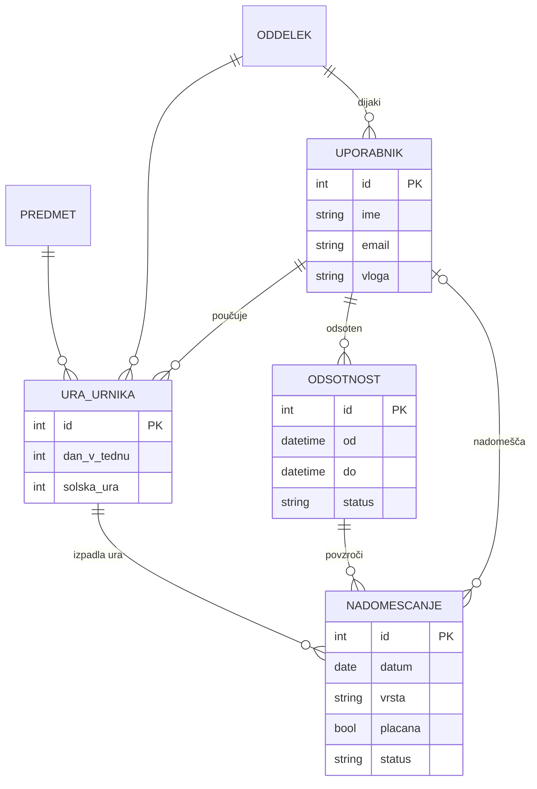

# 03 – Podatkovni model

Podatki so med seboj povezani (urnik, oddelki, učitelji, nadomeščanja), zato je izbrana relacijska baza **MySQL**.

## Entitete in glavna polja

| Entiteta | Glavna polja |
|---|---|
| **Uporabnik** | id, ime, priimek, email, geslo_hash, vloga, oddelek_id (samo dijak) |
| **Predmet** | id, kratica, naziv |
| **Oddelek** | id, oznaka (npr. 2. a) |
| **Ura urnika** | id, oddelek_id, predmet_id, ucitelj_id, dan_v_tednu, solska_ura |
| **Odsotnost** | id, ucitelj_id, od, do, razlog, status |
| **Nadomeščanje** | id, odsotnost_id, ura_urnika_id, datum, nadomescajoci_id, vrsta, placana, status, obravnavana_snov |

**Nadomeščanje** je osrednja entiteta: ena vrstica je ena izpadla ura na določen datum in njena rešitev.

## Povezave

- Oddelek, Predmet in Učitelj (Uporabnik) **1 : N** Ura urnika
- Učitelj **1 : N** Odsotnost
- Odsotnost **1 : N** Nadomeščanje (vsaka izpadla ura posebej)
- Ura urnika **1 : N** Nadomeščanje
- Učitelj **1 : N** Nadomeščanje (kot nadomeščajoči)
- Oddelek **1 : N** Uporabnik (dijaki)

## Osnutek modela

