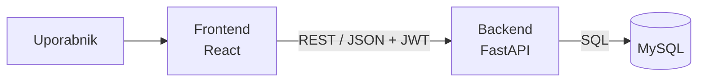

# 04 – Arhitektura in tehnološki sklad

## Arhitektura

- **Frontend** – spletna aplikacija v brskalniku (React), strani glede na vlogo uporabnika.
- **Backend** – REST API (FastAPI) s poslovno logiko: izpadle ure, predlog kandidatov, plačljivost.
- **Podatkovna baza** – MySQL.
- **Komunikacija** – frontend kliče backend prek REST API (JSON), backend dostopa do baze prek ORM (SQLAlchemy).
- **Avtentikacija** – račune ustvari administrator; prijava z e-pošto in geslom, backend vrne žeton JWT in preverja pravice glede na vlogo.
- **Lokalni zagon** – `docker compose up` zažene frontend, backend in bazo.

## Tehnološki sklad

| Področje | Tehnologija |
|---|---|
| Frontend | React + Vite |
| Backend | Python, FastAPI |
| Podatkovna baza | MySQL, SQLAlchemy |
| Avtentikacija | JWT, bcrypt |
| Lokalni razvoj | Docker Compose, Git + GitHub, VS Code |

## Arhitekturne odločitve

- **Ločen frontend in REST API** – ločitev prikaza in logike; API se lahko kasneje uporabi še drugje (npr. mobilna aplikacija).
- **FastAPI** – hiter razvoj in samodejna dokumentacija API-ja; sklad že poznam.
- **MySQL** – podatki so relacijski; MySQL je razširjen in ga pozna večina razvijalcev.
- **Docker Compose** – nov razvijalec zažene celoten sistem z enim ukazom.
