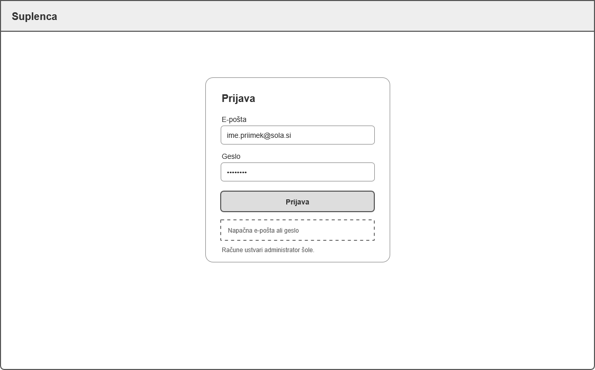
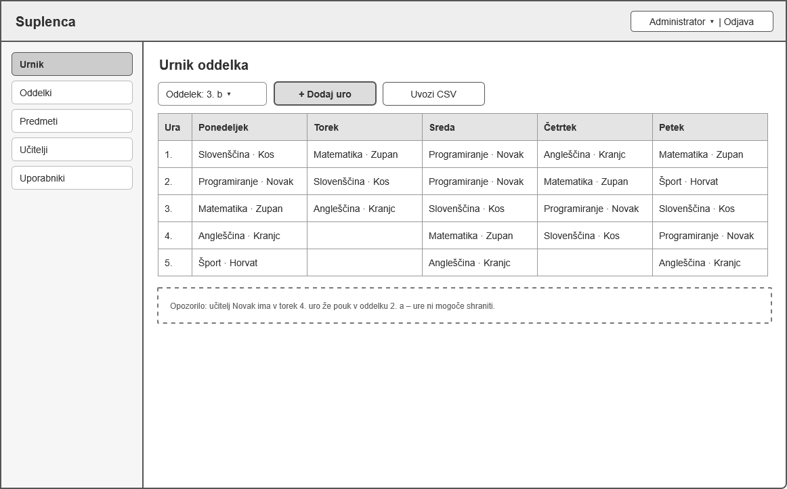
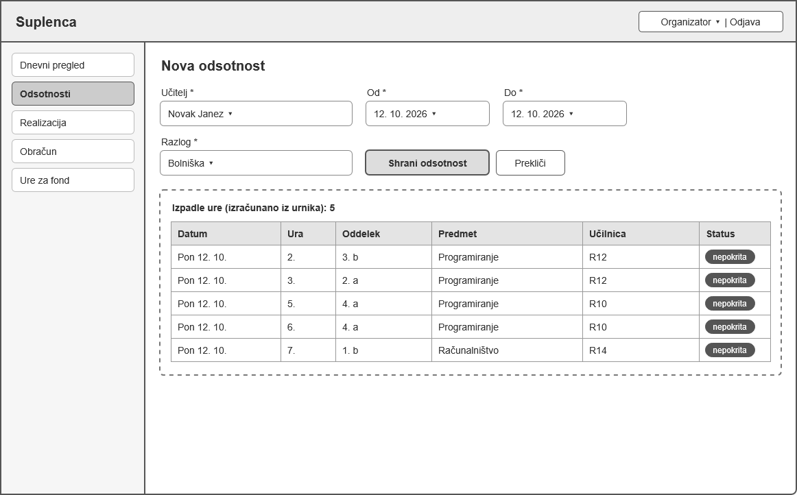
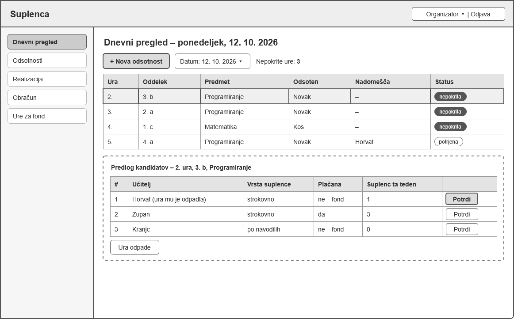
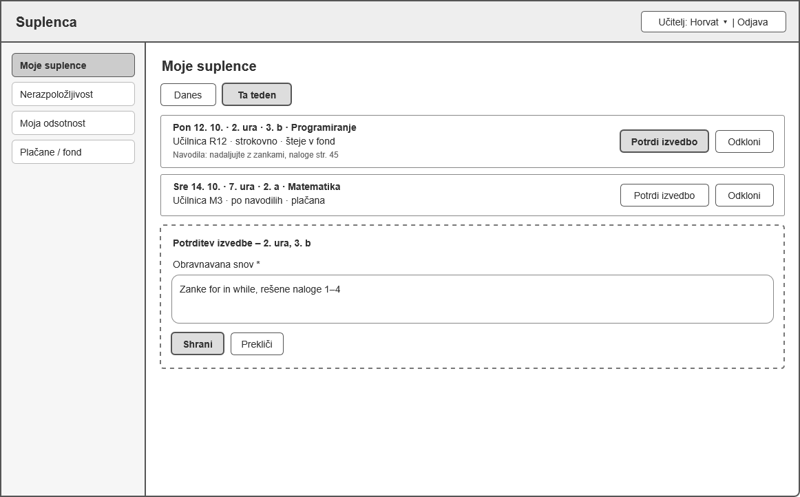
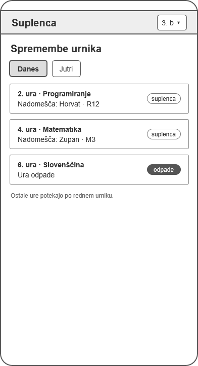

# 06 – Wireframes

Wireframe je preprosta skica zaslona brez barv in grafike, ki prikazuje le razporeditev vsebine in glavne gumbe. Skice sem izdelal v spletnem orodju **draw.io** (app.diagrams.net), vsak zaslon posebej, in jih izvozil kot slike. Prikazujejo šest zaslonov, ki pokrivajo vse zgodbe prve delujoče različice (MVP, US-01 do US-07).

## 1. Prijava

[Odpri sliko na Google Drive](https://drive.google.com/open?id=1LNRbsMr45G5P_olCC8kM-ynTQfwHHWwy&usp=drive_fs)

Prijava z e-pošto in geslom. Ob napačnih podatkih se prikaže sporočilo o napaki. Javne registracije ni, račune ustvari administrator.
*Zgodba: US-01.*

## 2. Administrator – urnik oddelka

[Odpri sliko na Google Drive](https://drive.google.com/open?id=1z62jmS2cvNkjAKpp9ik8alnyWpoJBTxd&usp=drive_fs)

Tedenski urnik izbranega oddelka (dnevi × šolske ure). Administrator doda uro ali uvozi urnik iz datoteke CSV. Če ima učitelj ob istem času že drugo uro, sistem vnos zavrne in prikaže opozorilo.
*Zgodba: US-02.*

## 3. Organizator – nova odsotnost

[Odpri sliko na Google Drive](https://drive.google.com/open?id=13buAxYqxKEa-OvpF9RX5P4uX1KrXJCfZ&usp=drive_fs)

Obrazec za vnos odsotnosti (učitelj, od – do, razlog). Po shranjevanju sistem iz urnika samodejno izračuna vse izpadle ure in jih prikaže s statusom »nepokrita«.
*Zgodba: US-03.*

## 4. Organizator – dnevni pregled in predlog kandidatov

[Odpri sliko na Google Drive](https://drive.google.com/open?id=17RlnHx_Gm3T_2Lo340jM92wH8eE6lkvY&usp=drive_fs)

Vse izpadle ure izbranega dne s statusom. Ob kliku na nepokrito uro se odpre predlog razvrščenih kandidatov z vrsto suplence, plačljivostjo in številom suplenc v tednu. Organizator kandidata potrdi ali uro označi, da odpade.
*Zgodbi: US-04, US-05.*

## 5. Učitelj – moje suplence

[Odpri sliko na Google Drive](https://drive.google.com/open?id=1MXEV5rCUnpfzTHxanCykYUoM3-Wv3v6u&usp=drive_fs)

Učitelj vidi svoje suplence za danes ali ta teden: termin, oddelek, predmet, učilnico, vrsto suplence, ali je plačana, in navodila odsotnega učitelja. Suplenco lahko potrdi (z obveznim vpisom obravnavane snovi) ali odkloni.
*Zgodbe: US-06, US-08, US-10.*

## 6. Dijak – spremembe urnika (mobilni prikaz)

[Odpri sliko na Google Drive](https://drive.google.com/open?id=1iCNr5KnHo2RbipjfJQhsHSlcLYY4jvkw&usp=drive_fs)

Dijaki stran najpogosteje odprejo na telefonu. Vidijo spremembe svojega oddelka za danes ali jutri: šolsko uro, predmet in nadomeščajočega učitelja ali oznako, da ura odpade. Razlog odsotnosti ni prikazan.
*Zgodba: US-07.*
